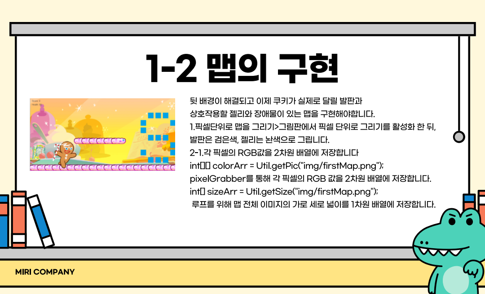
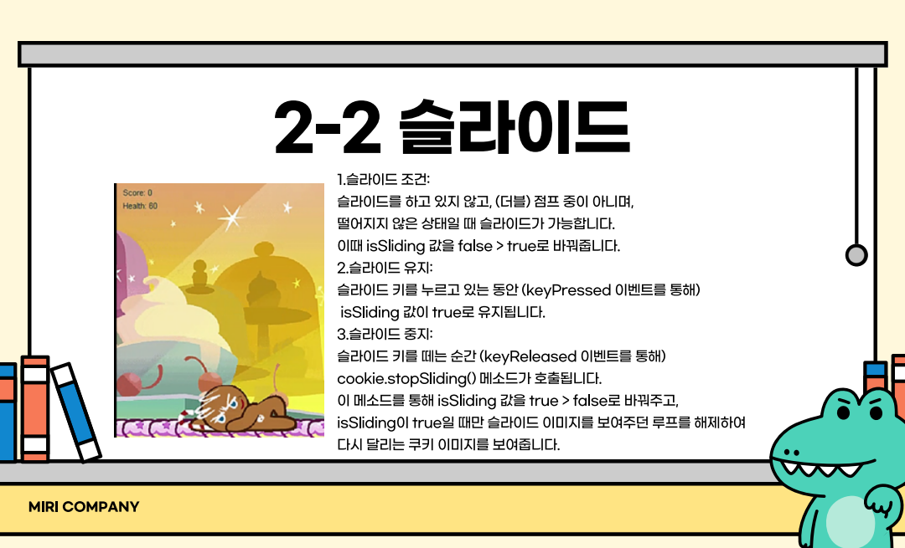
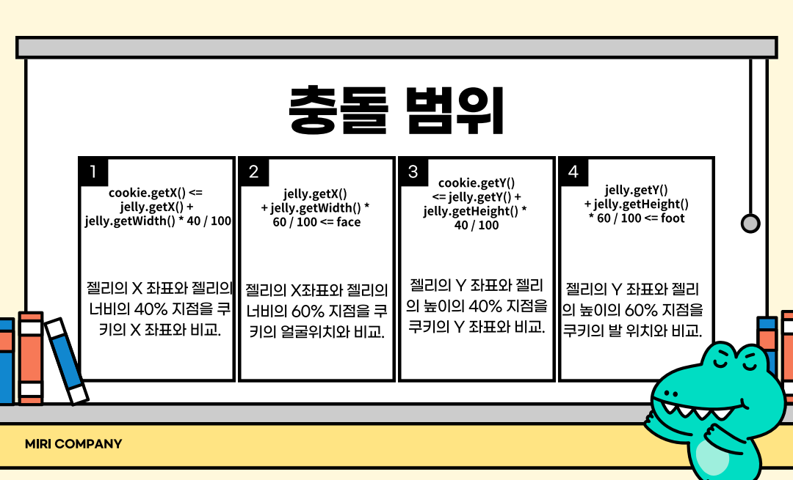

# 문석용 · 백엔드 개발자

Java와 Spring Boot로 여행 일정 생성과 투표 기능을 개발하고, React 화면을 서버 API에 연결했습니다. 사용자 요청과 외부 API의 응답이 어긋났을 때 어떻게 처리할지까지 생각하는 백엔드 개발자를 목표로 합니다. 프로젝트에서 마주한 문제와 선택을 기록합니다.

## 대표 프로젝트 · TokTrip

[TokTrip](https://github.com/Moonse01/toktrip)은 단톡방 대화로 AI 여행 일정 후보 두 개를 만들고, 친구들의 장소별 선호와 전체 일정에 대한 의견을 모아 최종 일정을 추천하는 서비스입니다.

- **AI 일정 검증** — 카카오 장소 검색으로 실제 장소와 목적지 범위를 확인하고, 조건에 맞지 않는 장소를 대체하거나 제외했습니다. [설계와 코드](https://github.com/Moonse01/toktrip/blob/main/docs/contribution.md#case-ai)
- **투표 저장** — 투표 가능 상태와 장소의 소속을 확인한 뒤, 같은 사용자가 같은 장소에 다시 투표하면 기존 표를 갱신했습니다. [설계와 코드](https://github.com/Moonse01/toktrip/blob/main/docs/contribution.md#case-vote)

## 다른 프로젝트

| 프로젝트 | 내용 |
| :--- | :--- |
| [OpenCV 콜라주 편집기](https://github.com/Moonse01/opencv-collage-editor) | 여러 사진에 각각 필터·밝기·스티커를 적용하고 한 장의 이미지로 저장하는 Python 수업 프로젝트 |
| [쿠키런 모작 발표 슬라이드 보기](#쿠키런-모작) | 맵에 발판과 젤리를 배치하고 더블 점프·슬라이드·충돌 처리를 구현한 Java 수업 프로젝트 |

### 쿠키런 모작

Java 수업에서 만든 2D 러닝 게임입니다. 아래는 당시 기말 발표자료의 일부입니다.

*맵 이미지의 픽셀 색을 읽어 발판과 젤리를 배치했습니다.*

슬라이드 동작과 젤리 충돌 판정 보기

**슬라이드 동작** — 키를 누르는 동안 슬라이드 상태를 유지하고, 떼면 달리기 상태로 복귀합니다.

**젤리 획득 판정** — 쿠키와 젤리의 좌표 범위를 비교해 충돌을 판정합니다.

## 교육

**대학기업협력형 SW아카데미 6기 · 2026.02.02~06.18**  
오브젠(주)이 제안한 「AI와 함께하는 통합 여행 플래너」를 선택해 2인 팀에서 TokTrip으로 구체화했습니다. [서경대학교 과정·참여기업 소개](https://sanhak.skuniv.ac.kr/cooperation-center)

## 사용 경험

**Java · Spring Boot · JPA · MySQL**  
React · JavaScript · Tailwind CSS · Python · OpenCV · Git · Docker Compose

## 학습 기록

- **Git · Java** — [Git 연습](https://github.com/Moonse01/GitPrcatice), [MyRepository](https://github.com/Moonse01/MyRepository)
- **Git · Python** — [hello-git](https://github.com/Moonse01/hello-git)
